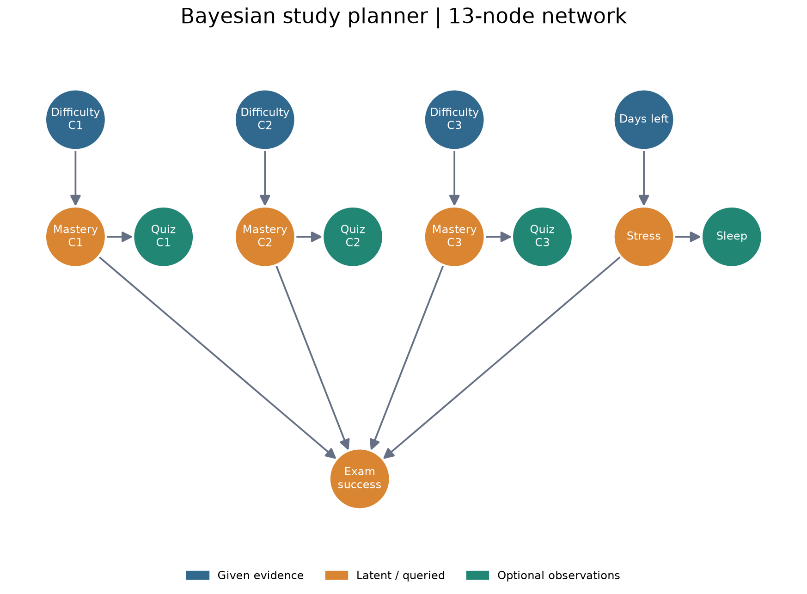
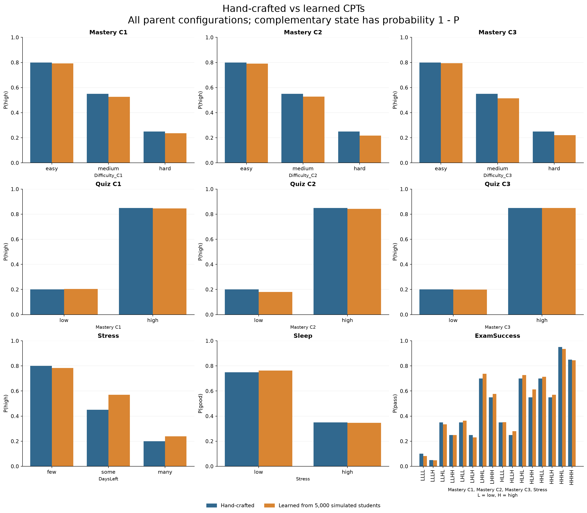
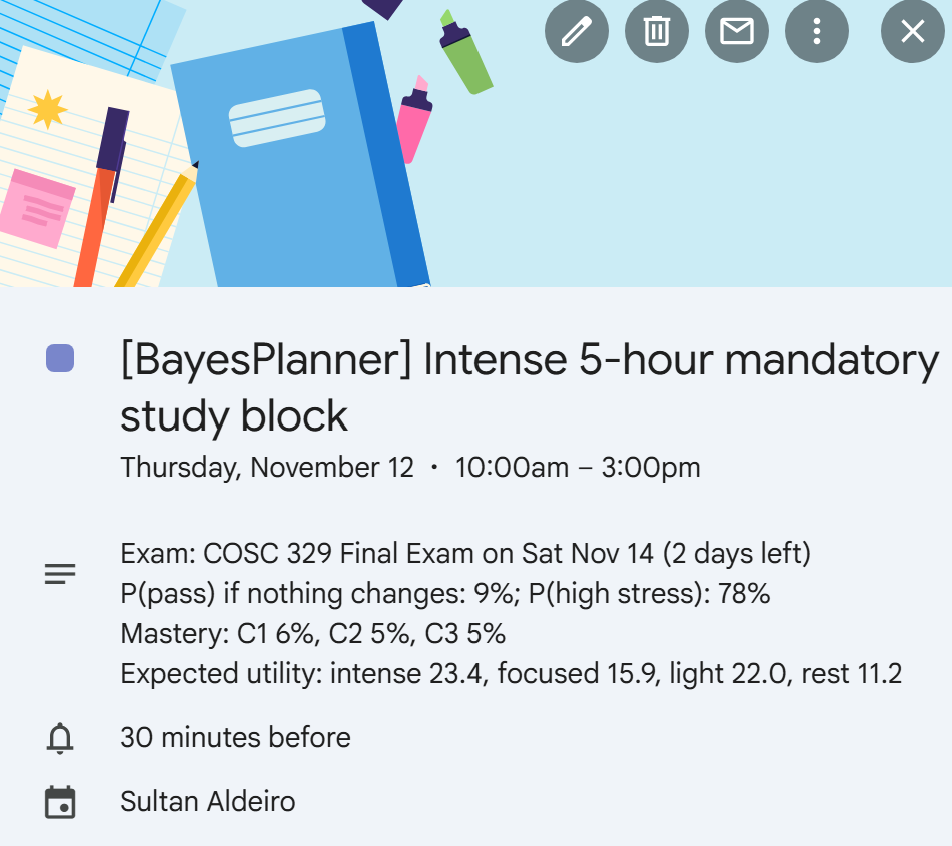
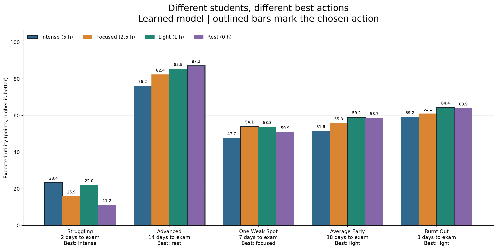

# Bayesian Study Planner

## COSC 329 Project Report

Sultan Aldeiro and John Kwon

November 12, 2026

## 1. Project aim

The main aim of this project is to help a student decide what kind of studying makes sense for today. A student might have an exam coming up, but that alone does not tell us whether they need a long study block, a short review, or a rest day. We also need to consider how well they know the material and how stressed they might be.

We built a Bayesian Study Planner that uses difficulty, practice quiz results, sleep, and the number of days before an exam as evidence. From here, the network estimates mastery of three concepts, stress, and the probability of passing. The decision part then compares four actions using expected utility. The chosen action can be written to Google Calendar or exported as an `.ics` file.

For example, a student who finds every concept hard and gets low quiz results two days before an exam receives a five-hour study block. A student who already knows the material and has two weeks left receives a rest day. The point is to show how different evidence leads to different decisions through the same model.

The project also includes a web dashboard. It lets us change the evidence and see the probabilities, action scores, and proposed session together. The data used in this project is simulated, so the results demonstrate how the system works. They do not establish how accurately it would predict a real student's exam result.

## 2. Network structure and initial probabilities



The network has 13 discrete nodes and 12 directed edges. Nine nodes describe difficulty, mastery, days left, stress, and exam success. The other four nodes represent practice quizzes and sleep. These observations are useful because a student cannot directly measure their mastery or stress as a probability, but they can report a quiz result or how they slept.

| Variable | States | Parents |
|---|---|---|
| Difficulty_C1, C2, C3 | easy, medium, hard | None |
| Mastery_C1, C2, C3 | low, high | Corresponding difficulty |
| Quiz_C1, C2, C3 | low, high | Corresponding mastery |
| DaysLeft | few, some, many | None |
| Stress | low, high | DaysLeft |
| Sleep | poor, good | Stress |
| ExamSuccess | fail, pass | All three mastery nodes and Stress |

DaysLeft is grouped into few for 0-3 days, some for 4-10 days, and many for more than 10 days. Difficulty and days left are the required evidence. Quiz results and sleep are optional. If these are unknown, the model leaves them unobserved instead of treating them as low or poor.

The direction of each edge describes our assumptions. Difficulty affects mastery, and mastery affects quiz performance. This means a quiz can give us evidence about mastery even though the arrow points from mastery to the quiz. Days left affects stress, while stress affects sleep. Finally, mastery and stress affect exam success. These are modeling choices for the project, rather than causal relationships established from real student data.

### Initial conditional probability tables

The hand-crafted model gives us a starting point that we can compare with learned probabilities later. A conditional probability table, or CPT, stores the probability of a variable's states for each combination of its parents.

| Probability | Hand-crafted values |
|---|---|
| Difficulty: easy, medium, hard | 0.30, 0.40, 0.30 |
| DaysLeft: few, some, many | 0.20, 0.40, 0.40 |
| High mastery given easy, medium, hard | 0.80, 0.55, 0.25 |
| High quiz result given low, high mastery | 0.20, 0.85 |
| High stress given few, some, many days | 0.80, 0.45, 0.20 |
| Poor sleep given low, high stress | 0.25, 0.65 |

For example, easy material starts with an 80% probability of high mastery, compared with 25% for hard material. Quizzes are also imperfect: someone with low mastery still has a 20% chance of a high quiz result. This allows the network to use quiz evidence without assuming that one quiz tells us everything.

Exam success depends on how many concepts are mastered and whether stress is high. The initial model treats all three concepts as equally important.

| Concepts mastered | P(pass), low stress | P(pass), high stress |
|---|---|---|
| 0 | 0.10 | 0.05 |
| 1 | 0.35 | 0.25 |
| 2 | 0.70 | 0.55 |
| 3 | 0.95 | 0.85 |

There are 16 parent configurations in the actual ExamSuccess CPT: eight mastery combinations, each with two stress states. The table above groups combinations with the same number of mastered concepts. The learned CPT later estimates each configuration separately.

## 3. Data and simulation

We used simulated data because the model needs difficulty, mastery, quizzes, stress, sleep, and exam outcome recorded together. Simulating these variables also lets us check the learning step against a process that we know. It does not give us evidence that the assumptions match real students.

The dataset contains 5,000 student records, generated with random seed 329. Each row has a student ID, the 13 network variables, and the raw number of days before the exam. The state names are the same as those used in the network.

The generator uses the following rules. Here, sigmoid(z) = 1 / (1 + exp(-z)), d is difficulty coded as 0, 1, or 2, and k is the number of mastered concepts.

| Variable | Generation rule |
|---|---|
| Difficulty | easy 0.30, medium 0.40, hard 0.30 |
| High mastery | Bernoulli(sigmoid(1.4 - 1.3d)) |
| High quiz result | Probability 0.85 if mastered, otherwise 0.20; add normal probability noise with standard deviation 0.03 and clip to a valid range |
| Days before exam | Uniform integer from 1 to 21 |
| High stress | Bernoulli(sigmoid(1.6 - 0.18days)) |
| Poor sleep | Probability 0.65 with high stress, otherwise 0.25 |
| Passing | Bernoulli(sigmoid(-2.2 + 1.6k - 0.6[high stress])) |

These rules make harder concepts less likely to be mastered and make stress more likely when the exam is close. They are close to the hand-crafted probabilities, but they do not copy every table exactly. This gives the learning step differences to estimate.

There are 36 free parameters across the nine learned CPTs: nine for mastery, six for quizzes, three for stress, two for sleep, and 16 for exam success. With 5,000 records, this works out to about 139 rows per parameter. That average alone does not tell us whether rare combinations have enough data, so we also checked the counts for each parent configuration. The smallest count is 236 records for an ExamSuccess parent configuration. Every learned parent configuration is represented in the dataset.

## 4. Learning the CPTs

We learn the CPTs for Mastery_C1-C3, Quiz_C1-C3, Stress, Sleep, and ExamSuccess. The four root priors stay hand-crafted because difficulty and days left are supplied as evidence when making a decision.

For each variable, the implementation counts the records for each state and parent configuration. We use Laplace smoothing with alpha = 1:

```text
P(X = x | parents = u) = (N(x, u) + 1) / (N(u) + number of X states)
```

This adds one count to every possible state. Without smoothing, a missing outcome could receive a probability of zero. With smoothing, a parent configuration that never appears gets a uniform distribution. For example, if 650 out of 1,000 stressed students slept poorly, the smoothed estimate would be 651 / 1002 = 0.6497. This is an illustration of the calculation, not a count taken from our dataset.



| Probability | Hand-crafted | Learned, rounded |
|---|---|---|
| High mastery for C1: easy / medium / hard | .80 / .55 / .25 | .79 / .53 / .24 |
| High quiz C1: low / high mastery | .20 / .85 | .20 / .85 |
| High stress: few / some / many days | .80 / .45 / .20 | .78 / .57 / .24 |
| Good sleep: low / high stress | .75 / .35 | .76 / .35 |
| Pass: all concepts mastered, low / high stress | .95 / .85 | .94 / .85 |

Across all 72 probability cells, the mean absolute difference is 0.020 and the largest difference is 0.120. The main difference is stress when there are 4-10 days left. The hand-crafted value is 0.45, while the learned value is about 0.57. This happens because of how the simulation's stress curve behaves within that bucket. From here, we can see that learning is recovering the simulated pattern rather than just returning our original table.

We also compared every learned CPT with pgmpy's K2 estimator, which uses add-one smoothing. The maximum difference is zero up to floating-point precision. This checks that our counting implementation agrees with the library. It does not check whether the probabilities are accurate for real students.

## 5. Inference

The inference task is to estimate each concept's mastery, high stress, and exam success after entering the evidence. We use exact variable elimination through pgmpy.

For example, in the hand-crafted model an easy concept starts with P(high mastery) = 0.80. If the student gets a high quiz result, Bayes' rule gives:

```text
P(high mastery | easy, high quiz)
  = (0.80 x 0.85) / ((0.80 x 0.85) + (0.20 x 0.20))
  = 0.944
```

So the quiz increases the estimate from 80% to about 94%. A low quiz moves the estimate in the other direction. Poor sleep similarly provides evidence about stress. This is why the optional observations are useful: students with the same difficulty ratings and exam date can still receive different estimates.

The displayed pass probability is the model's estimate before today's action. It is separate from the expected utility used to select an action.

## 6. Actions and expected utility

The planner compares four possible actions. Each action has a study duration, an assumed mastery benefit, and an assumed stress change.

| Action | Hours | Mastery boost | Stress change |
|---|---|---|---|
| Intense block | 5 | 0.35, all concepts | +0.20 |
| Focused session | 2.5 | 0.50, weakest concept | +0.03 |
| Light review | 1 | 0.20, all concepts | -0.04 |
| Rest day | 0 | 0 | -0.08 |

The mastery boost closes part of the remaining gap to full mastery. In the decision calculation, it is multiplied by an urgency factor: 1.0 for few days, 0.7 for some days, and 0.3 for many days.

```text
Updated mastery probability = p + boost x urgency x (1 - p)
Updated stress probability = clip(p_stress + stress_change, 0, 1)
```

For example, the focused action only updates the concept with the lowest estimated mastery. If two concepts tie, the first in the configured concept order is selected. The boosts and urgency factors are assumptions we set for the project; they are not learned from study-session outcomes.

The utility table gives a score to passing or failing with low or high stress. We also subtract one point for each hour of studying.

| Outcome | Low stress | High stress |
|---|---|---|
| Pass | 100 | 85 |
| Fail | 10 | 0 |

This means the model values passing, but also accounts for stress and the time spent studying. For each action, we enumerate the eight mastery combinations and two stress states. We weight the utility of passing and failing by the ExamSuccess CPT and the adjusted state probabilities, then subtract the time cost. The action with the highest expected utility is selected.

The calculation uses products of the adjusted mastery marginals and the stress marginal. With the current network and evidence, the separate branches factorize before the action. The action effects are still a simplified construction rather than an action-conditioned joint model learned from data. If the network were extended with shared causes or additional evidence, the independence assumption would need to be checked again.

For the struggling student, the learned-model utilities are 23.4 for intense, 15.9 for focused, 22.0 for light, and 11.2 for rest. Intense wins because the assumed benefit across all three weak concepts outweighs its stress and time costs. The difference from light review is only about 1.4 points, so we should not describe this as an obvious real-world choice.

## 7. Calendar and dashboard

The calendar code supports Google Calendar, local `.ics` files, and an in-memory calendar for tests and dashboard previews. Calendar exam discovery looks for event titles containing exam, midterm, or final. The planner can then compute days left from the exam date. The CLI demos instead supply a scenario exam date directly, and the dashboard takes the date entered in the form.

When planning a day, earlier planner sessions for that day are removed before the new session is created. A rest decision creates no session. This lets us run the planner again without stacking duplicate study blocks. Deletion is restricted to events whose titles start with `[BayesPlanner]`; the backend rejects deletion of untagged events.

The scheduler looks for the earliest available start in 30-minute steps from 10:00, with the session ending by 22:00. If no free slot exists, it falls back to 10:00. This is a limitation because the fallback can overlap an existing event. The calendar description includes the exam, probabilities, action utilities, and weakest concept when relevant, so the decision can be explained from the event itself.

The dashboard uses the same inference and decision code. It includes five student profiles, custom inputs, a learned/hand-crafted model selector, posterior bars, an expected-utility chart and table, and a network/CPT inspector. Its seven-day calendar shows today's preview only; future days are marked as unplanned. It uses a fresh in-memory calendar for each request and does not write to Google Calendar.

### Live calendar check

On November 12, 2026, Sultan completed the OAuth flow and ran the struggling scenario against Google Calendar. It created a `[BayesPlanner]` five-hour block from 10:00 to 15:00. The event showed a 9% pass estimate, 78% high-stress estimate, and the four utility values described above. These values belong to the simulated scenario, not Sultan's own exam performance.



After running the advanced scenario, Sultan confirmed that the study block was gone. This checks the live authentication, creation, and rest-day cleanup flow. The screenshot shows the created event; the removal was confirmed manually rather than captured in a second screenshot.

## 8. Results and testing

### Different students, different actions



| Student | Evidence summary | Chosen action | Best EU | Runner-up EU |
|---|---|---|---|---|
| Struggling | Hard concepts, low quizzes, 2 days left | Intense, 5 h | 23.4 | Light, 22.0 |
| Advanced | Easy concepts, high quizzes, 14 days left | Rest | 87.2 | Light, 85.5 |
| One weak spot | C3 hard with low quiz, 7 days left | Focused, 2.5 h | 54.1 | Light, 53.8 |
| Average, early | Medium concepts, good sleep, 18 days left | Light, 1 h | 59.2 | Rest, 58.7 |
| Burnt-out | Medium concepts, high quizzes, poor sleep, 3 days left | Light, 1 h | 64.4 | Rest, 63.9 |

All four actions appear across the five students. The one-weak-spot case is useful because its mastery estimates are about 79%, 79%, and 5%. A focused session on C3 makes more sense under this model than spending equal effort on all three concepts. For the burnt-out case, high quiz results already provide evidence of mastery, while poor sleep raises the stress estimate to about 91%. The model selects a light review rather than a longer session.

The selected actions are the same under the learned and hand-crafted models for all five profiles. However, several margins are small. Focused beats light by about 0.3 utility points for the one-weak-spot student. We think this is a reason to show the full comparison rather than presenting the recommendation as certain. It also makes sensitivity testing a useful next step.

### Two-week simulation

The longer demo runs the planner once a day for 14 days. It starts both students with an exam 14 days away, so the struggling student's starting date is different from the two-day scenario above. After studying, simulated true mastery increases by the action's boost. In this simulated student update, the boost is not scaled by urgency. A practice quiz becomes high once true mastery reaches 0.5.

| Result | Struggling student | Advanced student |
|---|---|---|
| Daily actions | Light review throughout | Rest throughout |
| Total study time | 14 hours | 0 hours |
| Quizzes | Low on days 1-3, high from day 4 | High throughout |
| Chosen-action EU | 21.6 initially; 59.3 on day 4; 51.8 on day 14 | 87.2 initially; 74.8 on day 14 |
| Baseline P(pass) | 12% initially; 56% on day 4; 50% on day 14 | 87% initially; 82% on day 14 |

The struggling student improves in the simulation because light study starts early and later quiz evidence changes. The pass estimate still drops slightly as the exam approaches because stress rises. This shows how evidence and time interact in the model. It does not prove that one hour per day would have these effects for a real student, since the simulated improvement follows the same kind of boost assumptions used by the planner.

### Automated checks

The final test run passes 144 tests. Coverage includes network structure and normalization, fixed-seed data generation, sparse-data smoothing, agreement with pgmpy, inference, all four decisions, calendar scheduling and deletion guards, the scenario demos, figure generation, and the dashboard API. API tests check both probability models, invalid evidence, missing data, and isolation between requests. Google API tests use a fake service; the live check above is separate.

The CLI demo reproduces five expected scenario actions and writes calendar exports without Google credentials. These checks support the implementation's consistency. They are not an evaluation of prediction accuracy on held-out real student data.

## 9. Limitations and possible improvements

The main limitation is the data. We generated it from assumptions close to the starting CPTs, so agreement between learned and hand-crafted values is expected. The model has not been evaluated against real quiz histories or exam outcomes. One improvement would be to collect consented student records and evaluate predictions on a separate test set, including whether predicted probabilities match observed outcomes.

The action effects are another weak point. We set the mastery boosts, stress changes, urgency factors, and utility scores ourselves. Learning the CPTs does not learn how much a five-hour study block actually helps. Since some utility margins are small, changing these assumptions could change the recommendation. A sensitivity analysis would show which decisions stay the same and which depend heavily on a particular setting.

The network also simplifies the student. It has only three equally weighted concepts, binary mastery and stress, and no direct memory of past sessions. In the two-week simulation, improvement enters the network through new quiz results; fatigue and stress do not accumulate across days. A model with time-dependent mastery and fatigue could represent this more realistically.

The calendar handles exams separately rather than optimizing a complete workload across courses. It also falls back to 10:00 when the day is full. A practical improvement would be to return a scheduling conflict and let the student choose another time or shorter session. The dashboard currently previews today only, and its learned model is cached until the server restarts after data changes.

We think the project shows the connection between evidence, inference, utility, and an actual calendar action clearly. The next step would be to test and improve the assumptions behind those decisions, rather than treating a working implementation as evidence that the recommendations are already reliable for real students.

## 10. Running the project

From the repository root, install `requirements.txt` in the Python environment. The following commands reproduce the data, learning output, tests, offline demo, and figures:

```text
python -m pip install -r requirements.txt
python -m study_planner.cli simulate
python -m study_planner.cli learn
python -m pytest -q
python -m study_planner.cli demo
python -m study_planner.cli figures
python -m study_planner.cli serve
```

The dashboard is served at http://127.0.0.1:8000. The offline demo writes `.ics` files under `output/`. Live calendar use requires the OAuth setup in `docs/GOOGLE_SETUP.md`; it is enabled explicitly with `demo --scenario struggling --google`. Credentials and tokens are excluded from version control.

### Implementation references

- `docs/MODEL.md` and `study_planner/config.py`: network states, probabilities, actions, and utility constants.
- `docs/DATA.md` and `study_planner/simulate_data.py`: generation rules and dataset structure.
- `study_planner/learning.py`, `inference.py`, and `decision.py`: parameter estimation, queries, and expected utility.
- `study_planner/planner.py` and `calendar_api/`: scheduling and calendar backends.
- `study_planner/scenarios.py` and `demo.py`: student scenarios and two-week simulation.
- `study_planner/api.py`, `web/`, and `tests/`: dashboard and automated verification.

The implementation uses pgmpy for the Bayesian network and exact inference, FastAPI for the API, Chart.js for the dashboard chart, matplotlib for report figures, and Google's Calendar API client for live events. Dashboard design guidance and attribution are documented in `docs/DASHBOARD.md`.
